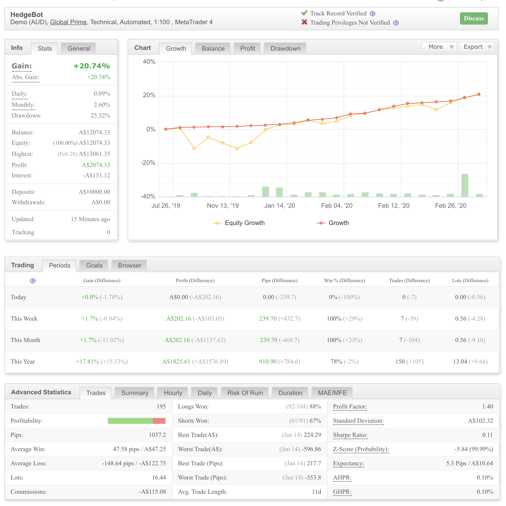
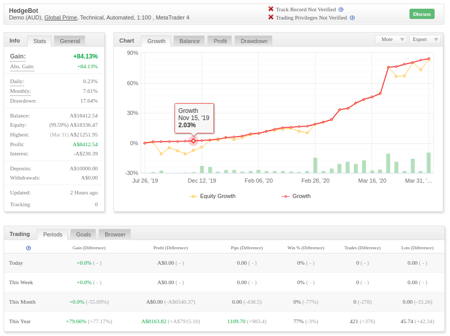
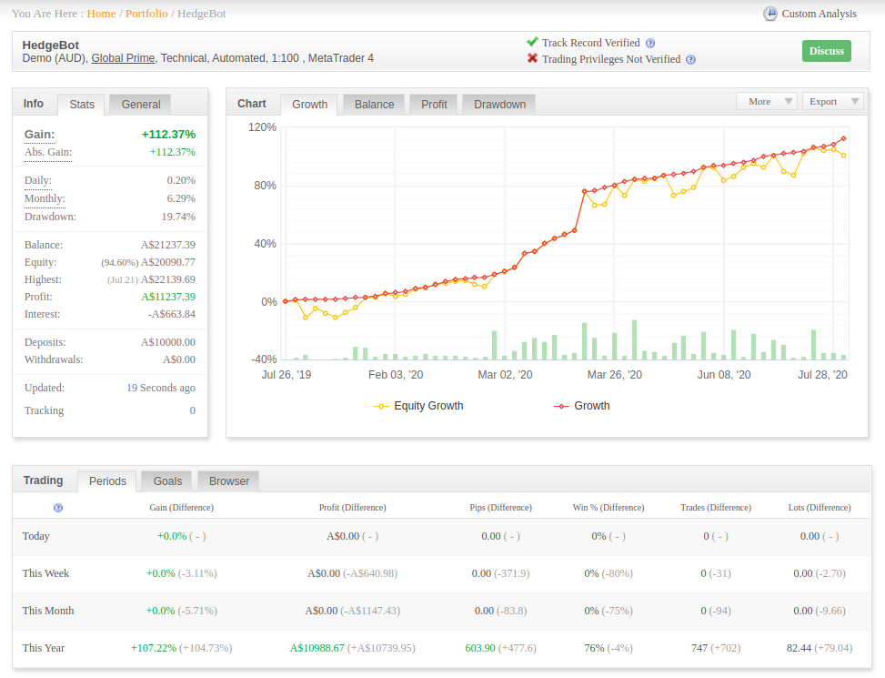
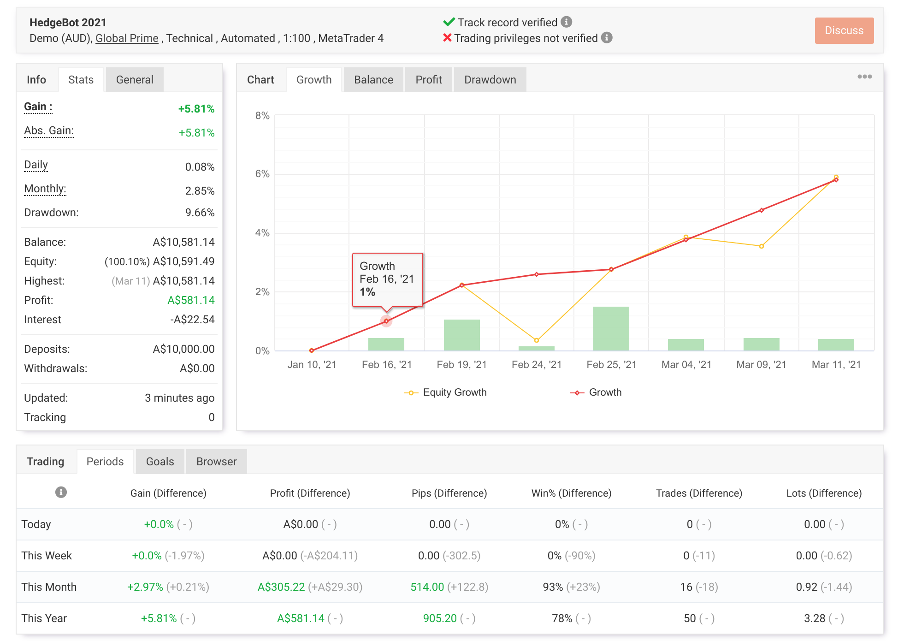
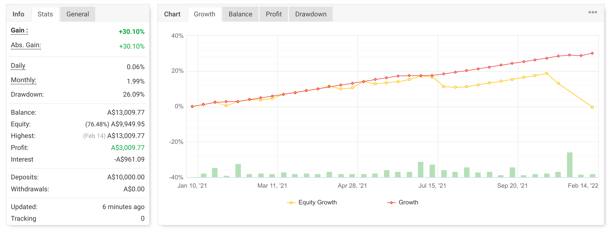
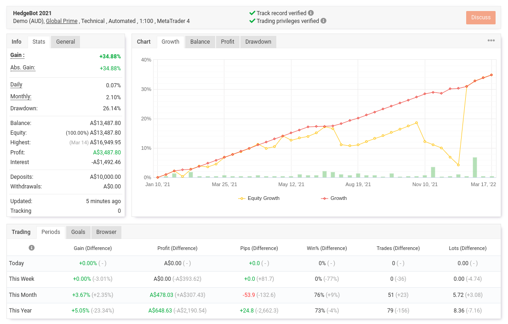
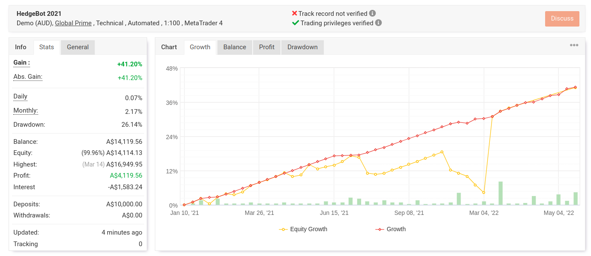
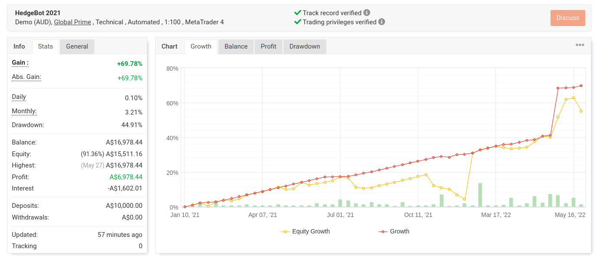
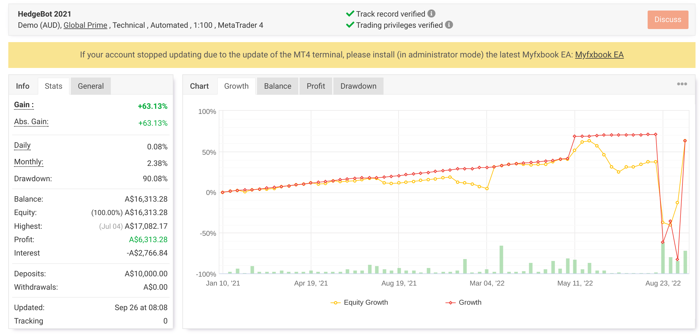
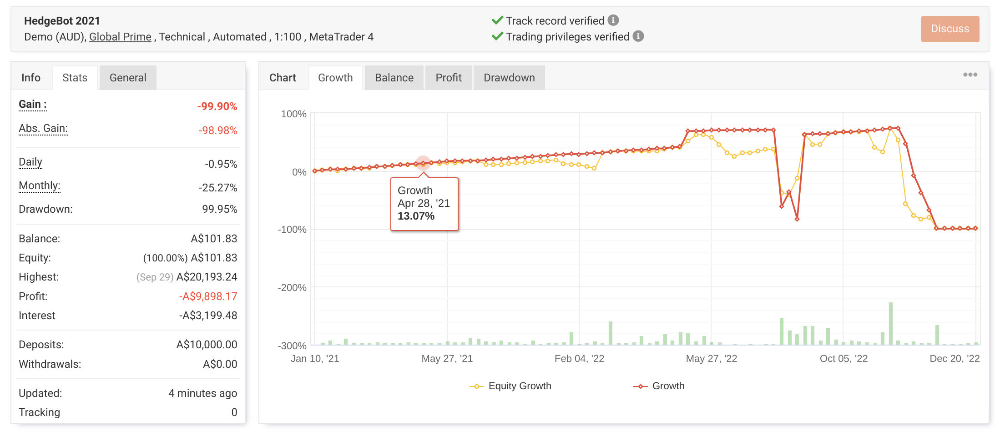

 # Inside Bar Grid EA

  Hedging EA for MetaTrader 4.

  This EA places multiple trades with increasing lot sizes on either side of an inside bar on a trending currency pair.

  It has mainly been tested on the `H4` timeframe. Trend detection is currently defined as a `20` period daily RSI greater than `55` or less than `45`.

  The system aims to close all open orders after reaching a modest overall profit while hedging losing positions.

  ## Notes

  - Some settings are still hard-coded.
  - In quiet markets, hedged trades can remain open for months.
  - In active markets, profits can arrive quickly.
  - During one month in 2020, profit increased by `14%`, but it had taken the previous seven months to reach `6%`.
  - The key to this system is keeping risk low with conservative settings.
  - Even with conservative settings, this is still high risk and would probably never be suitable for live trading because of black swan exposure.

  ## Progress Updates

  ### 2021-01-10

  The revised, more aggressive settings caused a series of margin calls and the account balance dropped to `$13,000`.

  Shortly after that, the computer running the systems malfunctioned and it took some weeks to get everything running again.

  Unfortunately, the broker had reset all demo accounts by then, so the final results and ending balance of that run are unknown.

  The system was restarted with less aggressive settings and screenshots would continue to be posted from time to time.

  ### 2022-02-10

  HedgeBot was running on a fresh demo account but was stuck with open `USDJPY` orders for some months while that pair remained range-bound.

  ### 2022-03-21

  HedgeBot finally closed the `USDJPY` trades after several months. This was the longest it had ever held trades open.

  Drawdown became a little extreme, but it pulled through in the end.

  It was still very risky, but it suggested the settings were at least workable.

  ### 2022-05-06

  The forex market had been trending on some pairs lately and HedgeBot had been doing well.

  ### 2022-06

  May brought some strong forex trends and the bot captured substantial gains, although it was still sitting in a little drawdown afterward.

  ### 2022-09

  This bot nearly blew up. It was stuck with open `EURGBP` buy and sell trades for nearly four months before the pair finally moved enough to bring the basket into profit.

  It also caused a margin call, resulting in roughly a `40%` loss of starting capital, which showed the settings had become too aggressive again.

  Then it looked like it might head for disaster again, but `EURGBP` finally made some large moves and all trades closed with about `60%` total profit.

  That result came down to luck.

  So this remained an extremely risky bot, especially with those settings.

  The plan was to de-tune the settings a little. Some milder hedging bots also seemed safer overall, but this one would keep running out of interest.

  ### 2022-12

  Blown account.

  This happened quickly when the EA entered a gold hedge trade. The bot could not account for the rapid price moves and the account was margin called.

  That may have been the end of HedgeBot. Hedging can work sometimes, but it is clearly very risky.

  Still, because this was only a demo account, it was worth restarting later with a few setting changes and with gold excluded from trading.

  ## Screenshots

  ### 2020-02

  

  ### 2020-04

  

  ### 2020-08

  

  ### 2021-03

  

  ### 2022-02-19

  

  ### 2022-03-21

  

  ### 2022-05

  

  ### 2022-06

  

  ### 2022-09-30

  

  ### 2022-12

  
